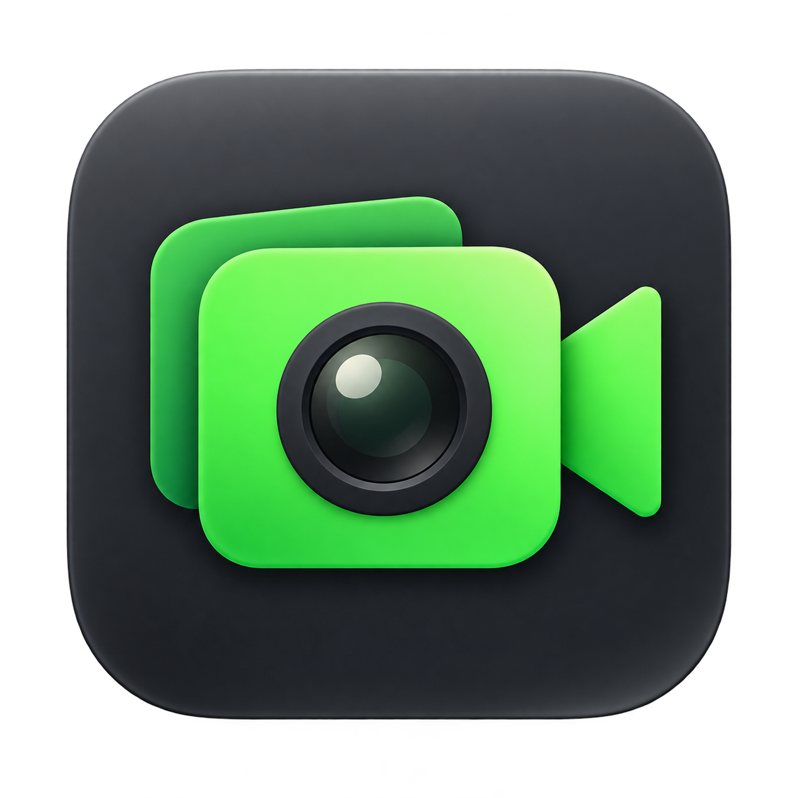

# AppleCam



AppleCam is a native macOS app with four shared scenes. Each scene combines ordered webcam, image, repeating video, browser, window and screen layers and publishes the finished picture as a virtual camera for video calls.

Built with Swift, SwiftUI, AVFoundation, Core Image, Metal and Apple's Core Media I/O Camera Extension framework. Video composition happens locally without third-party runtime dependencies. Browser layers contact the websites you open; other sources require no network service.

## Current status

Version **0.3.0, build 16** rearranges the window so the live output is always visible while editing, and fixes editing, flicker and stability bugs found in build 15. The source, unsigned verification build and locally development-signed build are updated; build 16 has not been installed, distributed, notarized or qualified in a real meeting. Build 14 remains the previously signed distribution. Signed and notarized builds have been produced, and the owner has confirmed Logitech BRIO output in Google Meet through Chrome. Microsoft Teams web and sustained conference-call performance remain acceptance targets, not completed qualifications.

The build-16 validation run passed **123 automated tests**; build 15's scene validation passed 115. A separate native AppKit integration check captured generated video through public WebKit snapshots, including an obscured rendering window, and verified silence, pause and resume. Local synthetic scene output was observed at about 30 fps in the app. These checks do not qualify live YouTube, screen permission UX, arbitrary cameras, or sustained Teams calls. Historical capture measurements and their limits remain in [the validation plan](docs/VALIDATION_PLAN.md).

## Release tags

Releases use annotated Git tags named `vMAJOR.MINOR` (for example, `v0.2`); patch releases use `vMAJOR.MINOR.PATCH` when needed. App versions retain all three components, so `v0.2` corresponds to app version `0.2.0`. Build numbers increase independently. Published tags are not moved.

- `v0.1`: build 14, the previous release with per-camera profiles, background shortcuts and approved branding.
- `v0.2`: build 15, shared scenes and editable media layers. Runtime acceptance limits are recorded above and in the validation plan; a source tag does not imply a notarized distribution.
- Version 0.3.0 (build 16) is committed but not yet tagged.

## Window layout

The window follows the macOS sidebar–content–inspector pattern, so the live canvas never scrolls out of view:

- **Sidebar** (left): the four scene buttons (⌘1–⌘4) and the selected scene's layers, front at the top. Drag rows to reorder, use the eye and lock buttons, right-click for more, press Delete to remove, and use **Add Layer** at the bottom.
- **Canvas** (centre): the live preview, with drag-to-move and a corner handle to resize the selected layer. The status bar shows state (Stopped / Preview / Sending), messages and frame rates. Toolbar: **Preview** (⌘R), **Send to AppleCam** (⇧⌘R), **Stop** (⌘.) and the inspector toggle.
- **Inspector** (right), with three tabs: **Layer** (scene name, canvas colour, and the selected layer's name, placement, Fit/Fill and source controls), **Green Screen** (samples, Picture/Mask preview and keying sliders), and **Output** (camera, capture format, canvas output format and camera extension installation).

Text and number fields apply on Return or when you leave the field, and Escape restores the current value. A value that isn't accepted beeps and reverts; blank names are rejected.

## Features

- GPU green-screen keying with up to six sampled screen colours.
- Tolerance, colour softness, foreground protection, small-hole filling and green-spill controls.
- Local Picture/Mask preview; the virtual camera receives the finished picture.
- Four named scene buttons, shared across camera selections, with independent ordered layer stacks.
- Live layer addition, rename, visibility, placement locking, drag reordering, drag/handle resizing, numeric position/size, aspect lock, Fit/Fill and canvas colour.
- Shared webcam capture with camera-specific green-screen calibration and capture format. Canvas output format is shared across all scenes.
- PNG/JPEG layers, including transparency, and private managed copies of imported images and clips.
- Silent, repeating macOS-decodable video clips. Inactive/hidden clips pause and resume in place when shown again; Play/Pause and Restart are explicit controls. Position is retained during this app session, not across quitting.
- WebKit browser layers with URL, viewport size, interaction and reload controls. Each active browser uses its own borderless rendering window and public WebKit snapshots, with one capture request at a time. Ordinary window occlusion is supported; the surface must remain ordered rather than minimized or closed. Inactive browser media and capture are suspended.
- Window/display layers selected through the system picker. Missing windows offer **Choose window…** or **Not right now**, which explicitly hides that layer while preserving its settings. No window is guessed from its title.
- Automatic versioned settings persistence, camera calibration, shared scenes and selected scene. Legacy v1/v2 background slots migrate into scenes, with a backup of the old settings. Other camera backgrounds are preserved as hidden layers.
- Restored settings never automatically start capture or sending. Visible source failures stop output; there is no substitute camera, source or automatic format reduction.

AppleCam provides video only. Keep your usual microphone selected in your meeting app. Its controls are in its own window and menu-bar menu. The ineffective Apple Video Effects button has been removed; use macOS's menu-bar video controls while a camera is active.

## Requirements

- Xcode with the macOS SDK and command-line tools selected. Development has been validated with Xcode 27 on macOS 27 and an Apple M1 Ultra Mac Studio.
- The project deployment target is macOS 15.2 (the picker identification APIs require it); older supported versions and other hardware have not been fully qualified.
- A built-in, external or Continuity camera exposed through AVFoundation. AppleCam discovers its resolutions and frame-rate ranges; the primary tested physical camera remains Logitech BRIO.
- A physical green screen for chroma keying; ordinary camera and non-camera scenes can also run without keying.
- macOS Screen Recording permission for window/display capture; network access for browser pages.
- Appropriate Apple Developer signing/provisioning for the camera extension and Developer ID distribution.

## Build and test

```sh
git clone https://github.com/ugubser/AppleCam.git
cd AppleCam
./scripts/verify.sh
```

The verification script runs the Swift package tests, builds the app and extension without distribution signing, and checks the embedded extension layout. Logs go to ignored `work/`; build products go to ignored `build/`. This does not install or activate the camera extension.

For tests alone:

```sh
swift test
```

A local development-signed build is available at `build/ScenesSigned/Build/Products/Debug/AppleCam.app`; the installed application is unchanged.

To test the browser capture path using only a generated local movie and a dedicated app-owned window:

```sh
python3 scripts/verify-browser-layer.py
```

This captures only its own generated page. It runs a real AppKit event loop rather than treating a WebKit screenshot in a unit-test host as acceptance.


Open `AppleCam.xcodeproj` in Xcode and select the **AppleCam** scheme to build the app. The shared scheme includes the embedded camera extension.

For a development-signed build using the configured team:

```sh
xcodebuild -project AppleCam.xcodeproj -scheme AppleCam -configuration Debug \
  -derivedDataPath build/Signed -allowProvisioningUpdates build
```

The project contains public bundle and team identifiers, but no signing credentials. To use another developer team, configure matching signing identities, bundle identifiers and entitlements for both targets, update the distribution export options, and adjust the integration-test signing expectations. Keep private keys and account credentials in Xcode or the keychain.

## Using the camera

1. Put the signed, notarized app in **Applications**, open it, and use **Install Camera Extension** in the **Output** inspector for the initial setup. Approve the extension in macOS settings if prompted.
2. In the **Output** inspector, select your camera and a supported capture format. Set the common canvas output size/rate (initially 1920 × 1080 at 30 fps). Scene changes keep that output format and transport connection.
3. Select one of the four scene buttons in the sidebar. Use **Add Layer**, select a source, and drag layer rows to arrange front-to-back order. Select a layer to name, position or resize it in the **Layer** inspector or directly on the canvas. Lock protects placement and ordering; visibility remains independently editable.
4. Click **Preview**. For a webcam green screen, open the **Green Screen** inspector, enable **Green screen**, select the webcam layer, and use **Replace Samples** on the backdrop. Sampling maps through the layer's placement/crop to the original camera buffer. Mask preview remains local only.
5. Add images, looping clips, browser pages, windows or displays as needed. Local media is copied into private app storage, so moving the original does not break the scene. Clips stay silent and resume when returning to their scene.
6. For browser pages, set the address (press Return to load) and viewport and use **Interact with Page** for playback/navigation. The source rendering window stays ordered while active; do not minimize it. Page playback/embedding restrictions and protected video remain website/OS constraints. AppleCam does not download YouTube streams or bypass player restrictions. Browser sessions are ephemeral and are not shared with Safari/Chrome. Web Audio is disabled in silent browser layers.
7. Click **Send to AppleCam**, select **AppleCam** in the meeting camera picker, and confirm its preview before joining a call. Keep the usual microphone selected; no media audio is sent.

Edits affect the selected scene live. Switching scene buttons selects a complete composition without restarting the virtual-camera transport. Hidden/inactive sources are paused/stopped and retained for returning to the scene. If a window has closed or its application restarted, choose it again or use **Not right now** to hide just that layer and continue. Cancelling the picker leaves output stopped; no replacement is selected. A visible source failure stops publication; receiving clients can retain their last picture.

**Preview** ends publication while keeping local composition running; **Stop** ends capture and publication. Camera and canvas format changes require Stop. Shared scenes persist across webcam changes; each camera retains its own key calibration, green-screen preference and capture format. A scene with no visible webcam does not request camera access. No camera, window or display frames are recorded by AppleCam.

The initial scene release uses immediate cuts and one selected display per screen layer. It does not include audio routing, transitions, video conversion, extra codec libraries, persistent browser accounts or recording.

Build 12 changes the camera extension: after replacing the app in Applications, click **Install Camera Extension** to update it. Follow any approval or restart requirement reported by macOS. Select **Send to AppleCam** and reselect AppleCam in the meeting preview to verify delivery. Updating the app alone does not replace an already activated extension.

The selected camera format applies to camera capture and keying; the common canvas format determines the composed frames sent into the extension. A meeting client can negotiate a different output resolution/rate; the extension preserves the whole picture with aspect-fit letterboxing and reduces cadence only when explicitly requested. It does not invent extra frames or change the physical camera setting. The extension advertises common resolutions plus attached-camera resolutions visible when its streams are created. A newly attached camera with an unusual resolution may require the extension to be recreated before that resolution can be published; local capture is independent of this catalogue. Unsupported publication formats report an error instead of changing the selection. Live format negotiation with the updated extension and browser remains an owner acceptance check.

Known issue (since build 15, macOS 27): in a browser layer whose rendering window is covered, a video you paused inside the page can start playing again after switching away from the scene and back. WebKit restarts it once on reactivation, and AppleCam then treats the automatic pause that follows as an interruption. The native browser harness reports this intermittently as "An explicit user pause was not preserved".

Apple effects are controlled by macOS and are not blocked by AppleCam. Effects applied separately in a meeting app may further change the finished picture.

## App icon

The approved green-camera logo is used in Finder, the Dock and the app window. The original artwork and generation prompt are in `artifacts/branding/`. To rebuild the bundled macOS icon from that source, run `./scripts/build-app-icon.sh`. The verification script checks its bundle reference, standard/Retina representations and transparency.

## Signed distribution

```sh
xcodebuild -project AppleCam.xcodeproj -scheme AppleCam -configuration Release \
  -destination 'generic/platform=macOS' -archivePath build/AppleCam.xcarchive \
  -derivedDataPath build/Distribution -allowProvisioningUpdates archive
xcodebuild -exportArchive -archivePath build/AppleCam.xcarchive \
  -exportPath build/Notarization -exportOptionsPlist Config/DeveloperIDExport.plist \
  -allowProvisioningUpdates
```

The export submits to Apple's notary service using the account configured in Xcode. After Apple accepts the submission:

```sh
xcodebuild -exportNotarizedApp -archivePath build/AppleCam.xcarchive \
  -exportPath build/Notarized
codesign --verify --deep --strict build/Notarized/AppleCam.app
xcrun stapler validate build/Notarized/AppleCam.app
spctl --assess --type execute --verbose=2 build/Notarized/AppleCam.app
```

Do not disable SIP or modify Apple's camera services to install the extension. Build archives, app bundles, signing material and local logs are excluded from Git.

## Project layout

| Path | Contents |
| --- | --- |
| `AppleCam/` | SwiftUI interface, camera model, capture, Metal processing and frame transport |
| `AppleCamCameraExtension/` | Core Media I/O virtual camera provider and streams |
| `Shared/` | Camera contract, timing, calibration, queue and preference models |
| `Tests/` | Unit, synthetic media and signing integration tests |
| `Config/` | App/extension metadata, entitlements and export configuration |
| `docs/` | Requirements, architecture, development plan and validation history |
| `artifacts/fixtures/` | Synthetic background fixture used in tests |
| `artifacts/verification/` | Reproducible validation summaries; historical records are dated |
| `scripts/verify.sh` | Local test and build verification |

Start with the [PRD](docs/PRD.md), [architecture](docs/ARCHITECTURE.md), [development plan](docs/DEVELOPMENT_PLAN.md) and [validation plan](docs/VALIDATION_PLAN.md). Some documents retain historical milestone notes; this README describes the current implemented behavior. Contributor rules are in [AGENTS.md](AGENTS.md).
